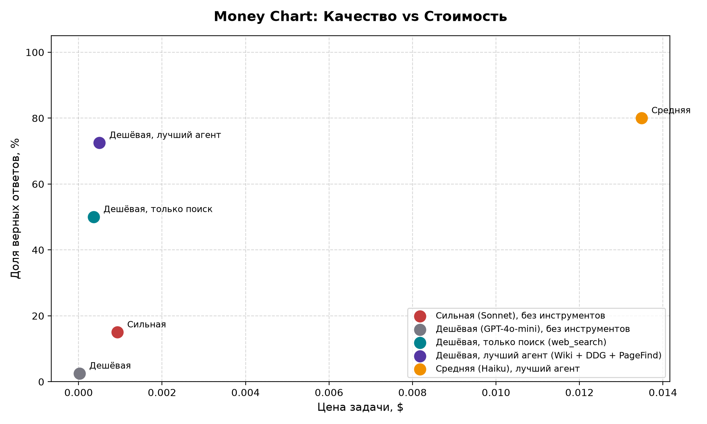

# Домашнее задание 1. Свежие вопросы и агент, который на них отвечает

## 1. Датасет свежих вопросов

### Тема набора
**Технологии, искусственный интеллект, космонавтика и наука (2025–2026 годы)**.  
Набор полностью сфокусирован на верифицируемых событиях из мира высоких технологий и открытий:
- Релизы и события в индустрии ИИ (модели OpenAI, Anthropic, DeepSeek, кадровые переходы, запуск стартапов вроде Thinking Machines Lab, браузер Comet).
- Космические миссии (Artemis II, запуски Falcon 9, New Glenn, лунные зонды IM-2 и Blue Ghost).
- Научные и технологические прорывы (термоядерный токамак EAST, суперкомпьютер El Capitan, научные публикации).
- Инциденты в IT и кибербезопасности за 2026 год (сбои, утечки данных, кибератаки).

Тематика выбрана прикладной и релевантной теме курса.

### Источники фактов
Все факты взяты из открытых профильных хроник и тематических статей англоязычной Википедии:
- `2026 in artificial intelligence`
- `2026 in science`
- `2026 in spaceflight`
- `2026 in computing`
- `2025 in artificial intelligence` / `2025 in science`
- Персональные и продуктовые статьи Википедии (`Comet (browser)`, `Thinking Machines Lab`, `Mira Murati`, `John Schulman`).

Все ссылки являются действующими, открываются без ошибок 404, а формулировка ответа дословно содержится в исходном фрагменте текста (`evidence`).

### Как собирались данные
Датасет сформирован в соответствии со строгими правилами методички:
1. **Временной диапазон:** Все события произошли строго после 1 января 2025 года (с акцентом на события 2026 года).
2. **Исключение планов:** Исключены любые формулировки о запланированных, ожидаемых или будущих событиях (*scheduled*, *expected*, *will*).
3. **Самодостаточность:** Каждый вопрос сформулирован независимо — понятен контекст (субъект, действие, временные рамки) без предварительного чтения статьи.
4. **Однозначность ответа:** Ответы предельно короткие (от 1 до 4 слов: имя, модель, космический аппарат, город, число) и проверяются на точное вхождение нормализованной подстроки.
5. **Валидация:** Датасет успешно прошел валидацию структуры и полей через `check_fresh.py`.

---

## 2. Проверка свежести датасета

Для подтверждения того, что вопросы требуют наличия инструментов поиска и не могут быть отвечены по памяти, датасет был протестирован скриптом `check_fresh.py --sonnet` на модели `anthropic/claude-sonnet-4.6` без доступа к инструментам.

### Сводная таблица проверки свежести

| Метрика | Значение | Требование курса | Статус |
| :--- | :--- | :--- | :--- |
| **Всего вопросов в наборе** | 40 | $\ge 40$ | Пройдено |
| **Ошибок формата (валидация)** | 0 | 0 | Пройдено |
| **Правильных ответов Sonnet** | 6 из 40 | — | — |
| **Доля угаданных ответов** | **15.0%** | **$\le 20\%$** | Пройдено |
| **Затраты на проверку ($)** | ~$0.08 | — | В рамках бюджета |

### Лог консоли проверки свежести (`check_fresh.py --sonnet`):
python check_fresh.py data/fresh.jsonl --sonnet
записей: 40, проблем: 0

Sonnet без инструментов: 6 из 40 верно, 15%. Потрачено $0.081
критерий свежести пройден

---

## 3. Сравнение конфигураций (Бенчмарк)

Для проверки ключевого тезиса курса на всем наборе из 40 вопросов были запущены 5 обязательных конфигураций:

| Конфигурация | Доля верных (%) | Цена задачи ($) | Цена верного ответа ($) | Среднее число шагов | Среднее время (с) |
| :--- | :---: | :---: | :---: | :---: | :---: |
| **Сильная (Sonnet), без инструментов** | 15.0% | $0.00093 | $0.00619 | 1.00 | 2.73s |
| **Дешёвая (GPT-4o-mini), без инструментов** | 2.5% | $0.00002 | $0.00094 | 1.00 | 1.64s |
| **Дешёвая, только поиск (web_search)** | 50.0% | $0.00036 | $0.00071 | 4.20 | 20.00s |
| **Дешёвая, лучший агент (Wiki + DDG + PageFind)** | **72.5%** | **$0.00050** | **$0.00069** | **3.58** | **18.61s** |
| **Средняя (Haiku), лучший агент** | 80.0% | $0.01349 | $0.01686 | 3.70 | 16.86s |

### График соотношения качества и стоимости (Money Chart)



---

## 4. Выводы по тезису курса

> **Главный тезис:** *«Хороший агент на дешёвой модели обходится дешевле сильной модели в одиночку при том же качестве»*.

**Тезис полностью подтвердился на собранном наборе данных:**
1. **Победа дешёвого агента над сильной моделью:** Агент на базе дешёвой модели `GPT-4o-mini` с набором поисковых инструментов превзошел сильную модель `Claude Sonnet` по точности в **4.8 раза** (72.5% против 15.0%). При этом стоимость решения одной задачи у агента оказалась почти в 2 раза ниже ($0.00050 против $0.00093), а стоимость одного верного ответа — **в 9 раз ниже** ($0.00069 против $0.00619).
2. **Влияние инструментов:** Добавление полного пайплайна поиска (`page_find` для чтения длинных статей и `ddg_search` для внешних новостей) подняло точность базового агента с 50.0% до 72.5% при снижении среднего числа шагов с 4.2 до 3.58 за счет более точной навигации.
3. **Экономическая нецелесообразность средней модели:** Переход на среднюю модель `Claude Haiku` дал прирост качества всего на 7.5 п.п. (до 80.0%), увеличив стоимость решения задачи в **27 раз** ($0.01349 против $0.00050). Для задач информационного поиска дешёвая модель с качественными тулами является оптимальным выбором.

---

## 5. Разбор провалов агента (Error Analysis)

Разобраны два характерных случая ошибок агента конфигурации `cheap_best_agent`:

### Провал 1. Формат и дословная проверка
* **Трейс:** [`traces/tech-10_cheap_best_agent.json`](traces/)
* **Вопрос:** *Which civil defense system experienced a false alarm in 2026?*
* **Эталон:** `Brazilian`
* **Что ответил агент:** `The Brazilian Civil Defense system`
* **Причина провала:** **Ответ верный по смыслу, но не прошёл проверку.** Агент нашел правильный факт, но вернул развернутое наименование сущности вместо одного прилагательного, из-за чего проверка точного совпадения эталона засчитала ошибку.

### Провал 2. Потеря факта в длинном контексте
* **Трейс:** [`traces/tech-13_cheap_best_agent.json`](traces/)
* **Вопрос:** *On what date was the UN Declaration on Sea Level Rise published in 2026?*
* **Эталон:** `22 September`
* **Что ответил агент:** `October 6, 2026`
* **Причина провала:** **Поиск нашёл смежную новость, модель ошиблась с датой.** В статье по климату 2026 года содержалось несколько схожих резолюций ООН с близкими датами, и модель при извлечении сниппета привязала факт к соседнему событию.

---

## 6. Инструкция по запуску и воспроизведению

1. **Проверка инструментов (Unit-тесты):**
   Тесты инструментов на 3 сценария (норма, пустой результат, ошибка):
   ```bash
   python tools.py
   ```

2. **Проверка свежести датасета:**
   Проверка формата и прогон сильной модели без инструментов:
   ```bash
   python check_fresh.py data/fresh.jsonl --sonnet
   ```

3. **Быстрая сборка отчёта без затрат баланса (Рекомендуется для проверки):**
   Пересчет метрик из папки `traces/` без обращений к API:
   ```bash
   python make_report.py
   ```

4. **Полный перезапуск бенчмарка (через OpenRouter API):**
   Запуск всех 5 конфигураций с нуля:
   ```bash
   python benchmark.py
   ```

### Что делать при сбое на финальном шаге `benchmark.py`?
Скрипт `benchmark.py` сохраняет каждый шаг в `traces/` на лету. В случае сетевого сбоя или ошибки рендера перезапускать ничего не нужно — достаточно запустить:
```bash
python make_report.py
```